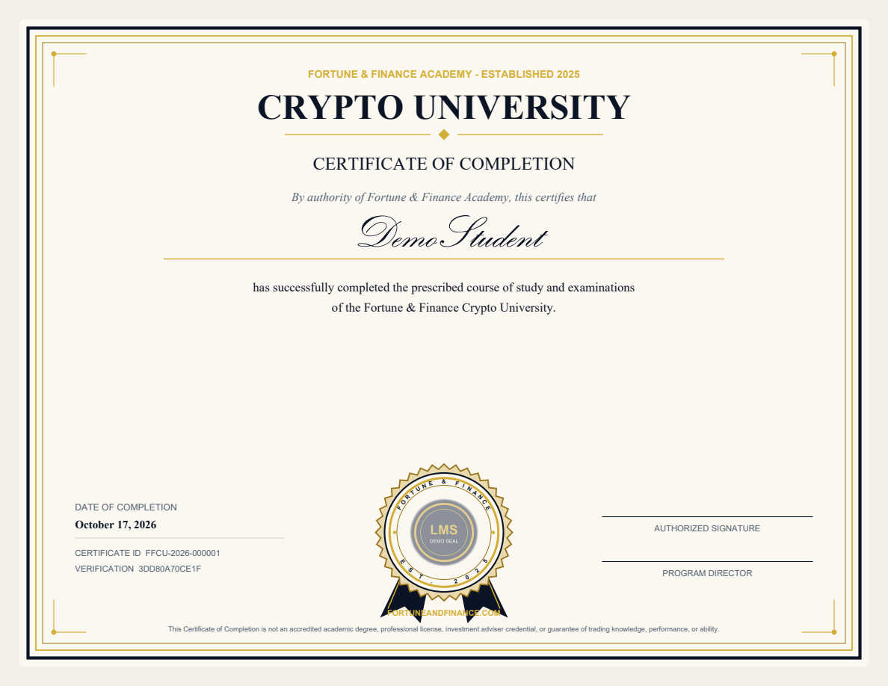
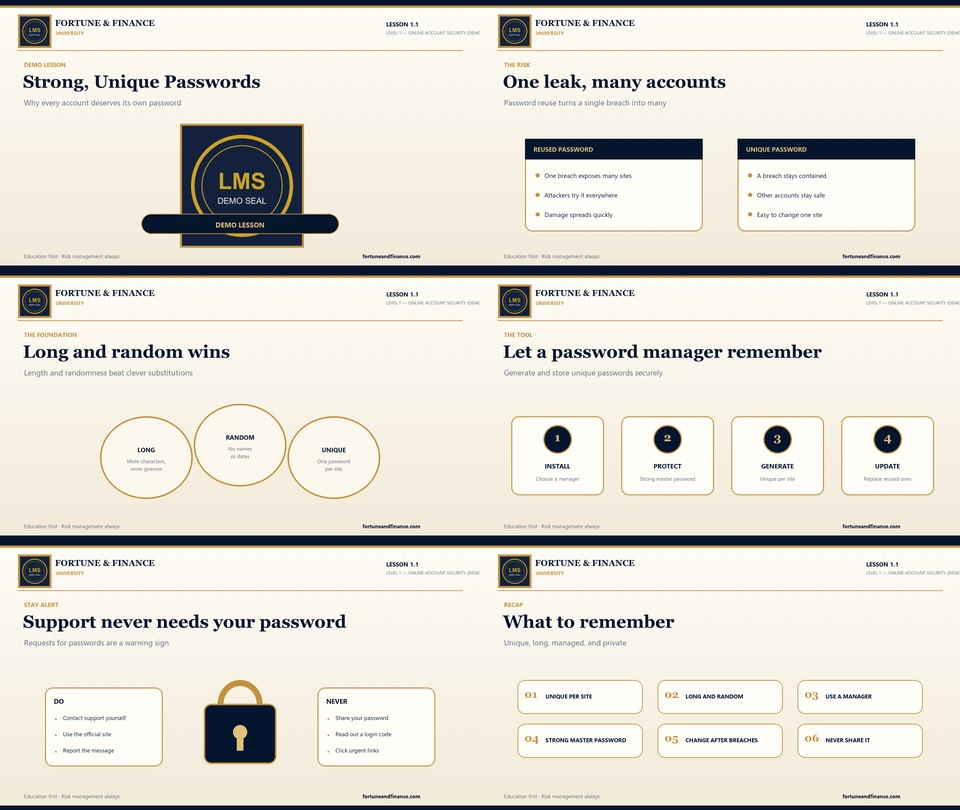

# Discord Learning Management Bot

A self-hosted Discord bot that runs a structured online course inside a Discord server. It has video lessons, prerequisite locking, randomized multiple-choice quizzes, level exams, a comprehensive final exam, professor-reviewed assignments, staff tools, Discord role awards, audit logs, and PDF certificates of completion.

I built it as the course platform for a paid crypto-education community (Fortune & Finance Crypto University). **This repository is a public demonstration.** It contains the complete application code, but the course content is a small sample written for this repo: a two-level course on account security with six lessons and 84 questions. The production curriculum, question bank, teaching material, and private video links are proprietary and are not included.



## What it does

- **Locked progression.** Students move through levels and lessons in order. Each lesson unlocks only after its prerequisites are passed, and each level exam unlocks only after every required lesson and assignment in that level is complete.
- **Randomized assessment.** Lesson quizzes and exams draw a random subset of questions from a bank and shuffle the answer order. A failed attempt shows the score and the topics to review, never an answer key. The pass mark (80% by default) is set in the course YAML and environment settings, and the retake cooldown is configurable.
- **Role-gated video.** The **WATCH CLASS** button sends an Unlisted YouTube link privately, and only after the bot confirms the member has the paid Student role.
- **Assignments.** Optional practical assignments can block a level exam until a professor approves the submission.
- **Staff tools.** Mentors get read-only progress views. Professors get those plus assignment review. Administrators can lock, unlock, reset, manually pass or fail a student, and issue a certificate, and every one of those actions is written to an audit log. All staff responses are ephemeral.
- **Certificates.** Graduates receive a PDF certificate (ReportLab) with a unique serial number. They can retrieve it later with `/my-certificate`.
- **Content as data.** The whole course (levels, lessons, prerequisites, question banks, exams, and assignments) is defined in YAML and validated before it is loaded. Reseeding updates the course without deleting student progress.
- **Lesson video pipeline (optional).** It renders a narrated 1080p lesson video from a YAML scene file, with slides, captions, a transcript, a thumbnail, and a report that maps the narration to the quiz questions. It can also upload the video to YouTube as Unlisted using OAuth with resumable uploads and upload receipts.

The bot is educational only. It never trades, connects to exchange accounts, holds funds, or asks for passwords, seed phrases, private keys, 2FA codes, or API keys.

## Tech stack

Python 3.12, discord.py 2 (slash commands, buttons, and views), SQLAlchemy 2 (SQLite by default, with PostgreSQL-compatible models), PyYAML, ReportLab, Pillow, and pytest. The video pipeline adds edge-tts, ffmpeg (through imageio-ffmpeg), and the YouTube Data API.

## Try it without Discord

The demo walkthrough uses the same course, quiz, and certificate services the bot uses. It runs one simulated student through the whole sample course: it confirms a locked lesson is refused, fails and retakes a quiz, passes every lesson and level exam, passes the final, and issues a certificate.

```bash
python -m venv .venv
.venv\Scripts\activate          # Windows; use source .venv/bin/activate on macOS/Linux
pip install -r requirements-dev.txt
python scripts/validate_content.py
python scripts/demo_walkthrough.py
python -m pytest
```

Expected results:

- `validate_content.py` prints `Content valid: 2 levels, 6 lessons, 84 questions.`
- The walkthrough ends with `Graduated: True | lessons completed 6/6` and writes a certificate PDF to `demo_output/certificates/`.
- pytest reports `29 passed`.

## Run it in Discord

1. Create an application in the [Discord Developer Portal](https://discord.com/developers/applications), add a bot, and enable **Server Members Intent**. Message Content Intent is not needed.
2. Install it to a test server with the `bot` and `applications.commands` scopes. Grant only View Channels, Send Messages, Embed Links, Attach Files, Read Message History, and Manage Roles (Manage Roles is needed only if the bot assigns level or graduate roles).
3. Copy `.env.example` to `.env` and fill in the bot token, server ID, staff and student role IDs, and the University Chat channel ID.
4. Run `python scripts/initialize_database.py` to load the course, then `python main.py`. On Windows, `setup.bat` and `run_bot.bat` do the same steps.

Slash commands sync to the configured server when the bot starts. `ADMIN_GUIDE.md`, `STAFF_GUIDE.md`, `STUDENT_GUIDE.md`, and `SERVER_DEPLOYMENT.md` cover operation in detail.

| Audience | Commands |
| --- | --- |
| Students | `/university`, `/start-university`, `/progress`, `/current-lesson`, `/continue`, `/help-university`, `/my-scores`, `/my-certificate`, `/assignments`, `/submit-assignment` |
| Mentors and professors | `/student`, `/student-progress`, `/pending-assignments`, `/assignment-review` |
| Administrators | `/university-admin`, `/university-stats`, `/student-lock`, `/student-unlock`, `/student-reset`, `/student-pass`, `/student-fail`, `/student-certificate`, `/course`, `/lesson`, `/quiz`, `/exam` |

## Lesson video pipeline

```bash
pip install -r video_production/requirements-video.txt
python scripts/render_lesson_video.py video_production/lessons/1.1.yaml
```

This renders the sample lesson to `video_output/lesson_1_1/`. These frames come from the demo render:



Verification status: I rendered the sample lesson on Windows and got a 1080p MP4, captions, a transcript, a thumbnail, and a quiz-coverage report. The neural voice (edge-tts) returned an HTTP 403 from Microsoft's service during that test, so the narration used the built-in Windows speech fallback. Neural narration was not re-verified for this demo. The YouTube upload code (`ffcu/services/youtube_upload.py`, `scripts/produce_all_videos.py`) is included but was not exercised for this repository, because it needs a Google OAuth client and a YouTube channel. `YOUTUBE_SETUP.md` describes the setup.

## Project structure

```text
ffcu/
  bot/            Discord client, slash-command cogs, embeds, buttons, role checks
  services/       course progression, quizzes, certificates, content loading, audit, backup, YouTube upload
  config.py       validated environment settings
  database.py     SQLAlchemy engine and session management
  models.py       ORM models
content/          sample course catalog and question banks (YAML)
video_production/ sample lesson scene file for the video renderer
scripts/          initialize, validate, demo walkthrough, backup and restore, video rendering
tests/            pytest suite
docs/             screenshots used in this README
```

## Tests

The 29 tests cover quiz scoring at the 80/79 pass boundary, duplicate-submission rejection, question and answer randomization, failed attempts that reveal topics but not answers, lesson locking, level unlocking, graduation rules, certificate ID uniqueness, the staff permission hierarchy, paid-role gating, video URL validation, YouTube upload safeguards (minimal OAuth scope, no public uploads), content integrity, and quiz coverage in the video scene file. One end-to-end test takes a student through every published lesson, every level exam, and the final, then issues a certificate.

The tests do not cover assignment gating, and they do not exercise the Discord layer against a live server.

## Demo limitations

- The sample course is short and deliberately generic. The production deployment uses a much larger private curriculum with the same schema.
- `content/video_urls.yaml` is empty, so the **WATCH CLASS** button has no video to link in the demo.
- The production release audit and handoff packaging scripts are private and not included.
- SQLite is the default. The models are written to be PostgreSQL-compatible, but this demo was only run on SQLite.

## AI-assisted development

I designed and directed this project and built it with AI coding assistants, including OpenAI Codex and Cursor, which wrote and refactored much of the code, documentation, and tests. I defined the product requirements, course rules, permissions model, and content structure, and I reviewed and tested the results. Preparing this public demo (the sample course, the walkthrough script, and removing production course text from the video renderer) was also done with AI assistance and checked by running the tests and the walkthrough.

## License

Copyright © 2026 George (FortuneGroot). All rights reserved. This code is published for portfolio review. No license is granted for reuse or redistribution without permission.
